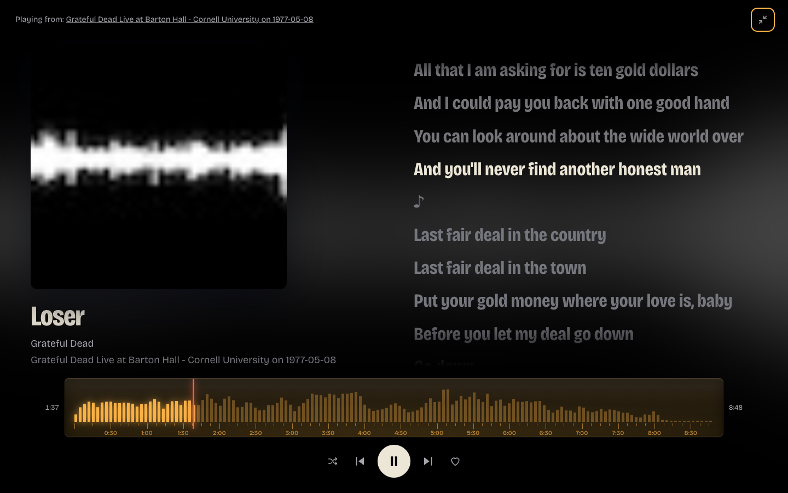
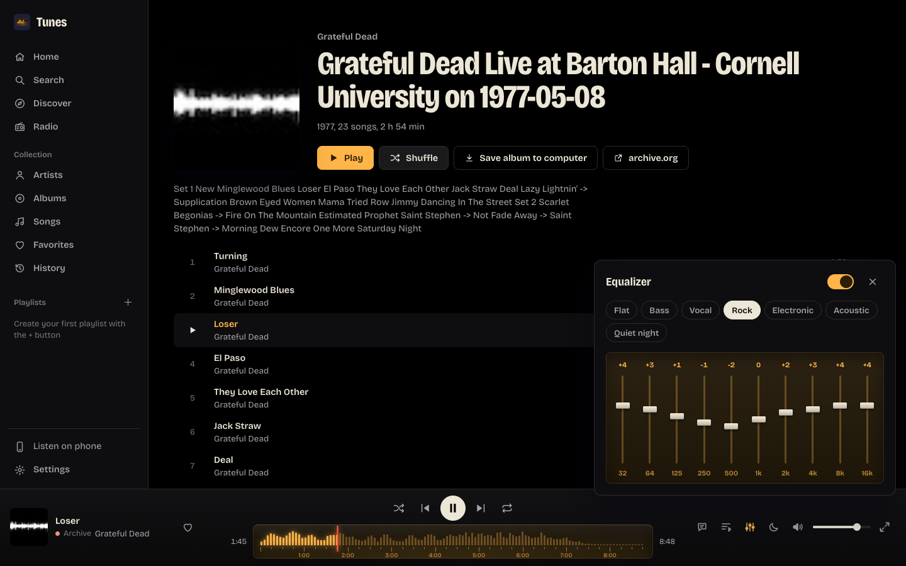

# Tunes

**A self-hosted music player with no subscription.** It combines the music on your computer with free, legal sources in one interface: independent artists, live concert archives, internet radio and synced lyrics.

The interface is in English, Bosnian, Serbian, Croatian, Slovenian, Macedonian, Albanian, German, Spanish, French, Portuguese and Turkish. It starts in English; pick another language in Settings any time without stopping the music. Your theme, colors, language and player look follow you to every browser and device.

[Bosanski README](README.bs.md)


## Why

Self-hosted players like Navidrome or Jellyfin are great for your own files, but they usually need Docker or a server setup, and they don't help you find new music. Streaming services need a monthly subscription. Tunes sits in between:

- It runs with a double-click on your computer. No Docker, no database server.
- Your local library and legal online sources show up in one search, one queue and one history.
- You can open it on your phone by scanning a QR code.

## Sources

| Source | What you get | Key needed |
|---|---|---|
| Folder on your computer | MP3, FLAC, M4A, OGG, WAV… with covers and tags | – |
| [Audius](https://audius.co) | Independent artists who publish their music for free streaming | – |
| [Internet Archive](https://archive.org/details/etree) | Live Music Archive (concerts shared with the artists' permission), netlabels, old 78 rpm records | – |
| [Radio Browser](https://www.radio-browser.info) | 40,000+ internet radio stations, with the song playing live | – |
| [hearthis.at](https://hearthis.at) | DJ mixes and electronic music (offline copies where the artist allows downloads) | – |
| [SoundCloud](https://soundcloud.com) | Songs, sets and artists from a pasted link, through SoundCloud's own player | – |
| [LRCLIB](https://lrclib.net) | Lyrics, often synced to the music | – |
| [ListenBrainz](https://listenbrainz.org) | Listening history, stats and recommendations (optional) | token |
| [Jamendo](https://www.jamendo.com) | Creative Commons music (optional) | client ID |

## Features

- **One search across every source**, with categories: songs, sets & mixes, albums & concerts, artists, radio stations. Hover a source to see what it offers
- **Sets & mixes detection:** recordings of 20+ minutes and titles like "DJ set", "mixtape" or "Boiler Room" are recognized automatically
- **Discover:** popular and trending music from Audius, DJ mixes by genre from hearthis.at, concerts from the Internet Archive
- **Library by artists and albums**, built from tags (or the folder structure when tags are missing). New files appear on their own. Audius artist pages with all their songs and sets
- **Playlists** that mix local and online songs, drag-and-drop reordering, M3U export
- **Smart playlists:** My mix, Most played, Forgotten favorites, Recently added, Never played
- **Favorites, shuffle, repeat, play queue, sleep timer**; one button opens the queue and lyrics panel, and any queued song plays from its cover
- **Listening history** of everything you play (songs, mixes and radio stations), each one once per day with its play count, plus top artists. Optional ListenBrainz scrobbling with their rule (half the song or 4 minutes)
- **Downloads for offline listening:** download a song, album, playlist or your favorites and it stays on the device until you remove it, for trips without internet. Sort, search and reorder them on the Downloads screen
- **10-band equalizer** with presets
- **Player styles:** a receiver-style dial with a live spectrum analyzer, Minimal (just a line), Mirror or Colors; click or drag to seek. Radio stations get an FM scale
- **Player buttons where you want them** (computers): shown only when the mouse is over the player bar (default), above the progress bar, or beside it in one row
- **Full-screen "Now playing"** with synced lyrics; the queue button swaps the lyrics for the play queue without leaving full screen. Lyrics come from the file itself (embedded, or a `.lrc` file next to it) or from LRCLIB, but only when artist, title and length all match
- **Mini player:** a small always-on-top window (Picture-in-Picture) with the cover, the buttons and the progress
- **Save to library:** download songs whose license allows it (Internet Archive, Jamendo, Audius where enabled)
- **Spotify playlist import** through an [Exportify](https://exportify.app) CSV: finds the songs you already own and lists what's missing
- **Listen on your phone:** one click shows a QR code; the link carries a secret key, so nobody else on the network can get in. On phones the player is a compact bar, and all the controls are in "Now playing"
- **Away from home through [Tailscale](https://tailscale.com):** a second QR code that works anywhere your phone has internet
- **Continue on another device:** start a set on your laptop, tap *Continue here* on your phone and it picks up at the same second while the laptop pauses. Music plays on one device (or tab) at a time
- **SoundCloud links:** paste a song, set or artist link into Search and it plays through SoundCloud's official player (SoundCloud's own search needs a paid API key)
- Media keys and Control Center on macOS, installable as an app (PWA), keyboard shortcuts
- Twelve languages; black, "night indigo" and light themes
- **Make it yours:** eight accent colors, any color you pick, or colors taken from the cover of the song that plays; Now playing over a blurred cover, cover colors or a plain background; small, normal or large text and roomy or compact song lists (per device), with a live preview in Settings. Settings are split into three tabs: Appearance, Music, and Playback & data
- **Share a song:** send a link to anyone (WhatsApp, Messages…; on a computer copy it or show a QR code). It opens in the free phone-only version, ready to play, keep or add to a playlist, with no account or app. Online songs and stations only: files on your computer stay yours
- **Only what you use:** turn off sources you don't need (they leave the menu, Search, Discover and Home), and choose which sections Home shows and in what order
- **Add to Home Screen** on iPhone and Android, with a guide that also sets up the Tailscale version
- **Offline buffer:** the current and next songs are downloaded to the phone, so music keeps playing if the connection drops. Songs not played for 3 days are deleted automatically
- **App icon:** pick one of four icons in Settings → Appearance; the choice applies to all your devices
- **Phone-only version** at <https://ajdinl.github.io/tunes/>: no computer or server needed, open the link on a phone and add it to the Home Screen. Online sources, favorites, playlists, history and downloads, all kept on the phone

| Now playing with synced lyrics | Equalizer |
|---|---|
|  |  |

| Internet radio with live song titles | On a phone |
|---|---|
|  |  |

## Getting started

You need [Node.js](https://nodejs.org) 22.18 or newer.

```bash
git clone https://github.com/ajdinl/tunes.git
cd tunes
npm install
npm start
```

Then open <http://localhost:4545>. `npm start` builds the interface first (about a second), then starts the server. Open windows (a tab, the app in the Dock, the phone) update themselves when a new build of the interface appears: right away if nothing is playing, otherwise they offer a Reload button. On macOS you can also double-click `start.command`.

Put your music in `~/Music/Tunes`, or add other folders under **Settings**.

### On your phone

Click **Listen on phone** in the left menu and scan the QR code with your phone camera. The phone must be on the same Wi-Fi network. Turning access off invalidates the old link.

On the phone, **Add to Home Screen** in the menu shows how to install Tunes as an app on that phone (iPhone: Share → Add to Home Screen). To listen away from home, install [Tailscale](https://tailscale.com/download) on the computer and the phone (same account) and use the **Away from home (Tailscale)** tab. The computer has to stay on.

When something is playing on one device, the other one shows a **Continue here** bar. Tap it to pick up the same song at the same second.

### As an app

Click **Install app** in the left menu. Where the browser can install apps (Chrome, Edge, Brave) that opens its install dialog right away; elsewhere it shows the one or two steps for that browser (Safari: **File → Add to Dock**). On phones the same button is called **Add to Home Screen**.

## Configuration

| Variable | Default | Meaning |
|---|---|---|
| `PORT` | `4545` | Port for the web interface (phone access uses `PORT + 1`) |
| `HOST` | `127.0.0.1` | Interface to listen on |
| `DATA_DIR` | `./data` | Where favorites, playlists, history and the library cache are stored |

Your data lives in `data/db.json`. You can download a backup under **Settings → Backup**.

## How it works

- `server.ts`: a small Node.js HTTP server in TypeScript with no framework. Node 22.18+ runs it directly (no build step); `npm run typecheck` checks the types
- `lib/library.ts`: scans folders, reads tags with [music-metadata](https://github.com/Borewit/music-metadata) and watches for changes
- `lib/sources.ts`: Audius, Internet Archive, Radio Browser, Jamendo, hearthis.at, SoundCloud (oEmbed), LRCLIB and ListenBrainz clients
- `lib/proxy.ts`: streams audio through the local server, so the equalizer and spectrum analyzer work for every source, and reads live song titles (ICY metadata) from radio streams
- `web/`: the interface in React + TypeScript, built with [Vite](https://vite.dev) into `web/dist`. `web/src/lib` holds the parts without UI (player engine, offline buffer, SoundCloud adapter, router, translations); `web/src/shell` the player bar, panels and dialogs; `web/src/views` the screens
- `lib/types.ts`: the data shapes shared by the server and the interface
- `public/`: icons, the web app manifest and the service worker

For working on the interface, `npm run dev` starts Vite with hot reload on <http://localhost:5173> and sends API requests to a running Tunes server (`npm start`).

## Tests

```
npx playwright install chromium   # once
npm test                          # type check, build, unit and API tests (Vitest), end-to-end tests (Playwright)
```

The tests start their own servers with a generated music library and a fake internet, so they never touch your data and work offline. See [tests/README.md](tests/README.md).

## Legal

Tunes only uses sources that offer their music for free streaming, and only downloads files whose license allows it. It does not rip music from YouTube, Spotify or other subscription services.

## License

[MIT](LICENSE)
