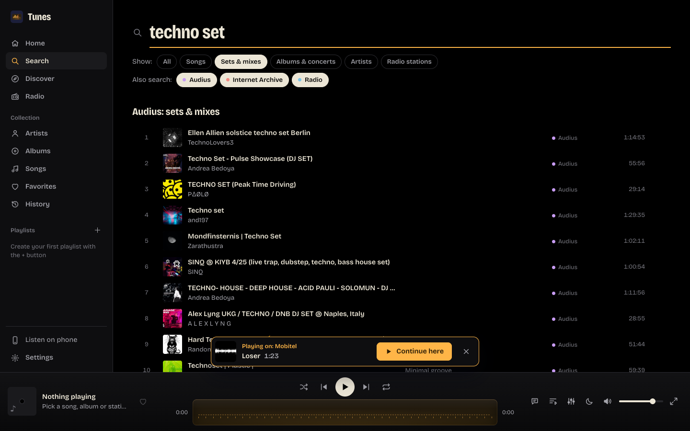
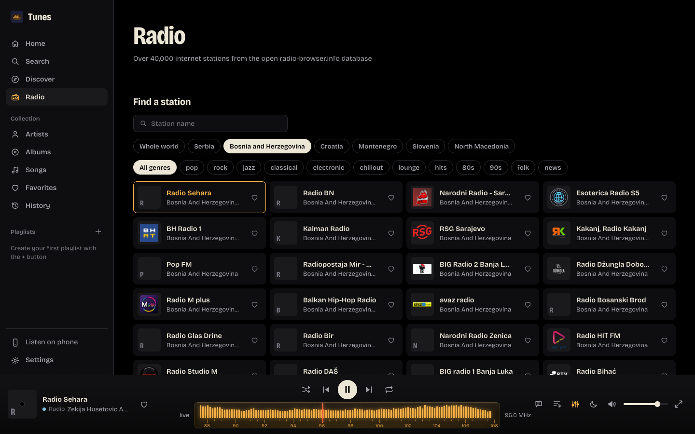
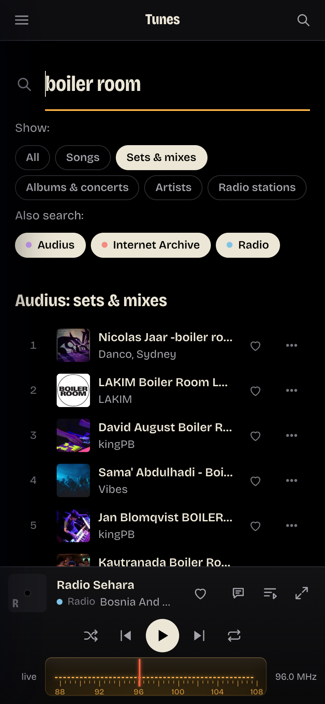

# Tunes

**A self-hosted music player with no subscription.** It combines the music on your computer with free, legal sources in one interface: independent artists, live concert archives, internet radio and synced lyrics.

The interface is available in Bosnian and English.

[Bosanski README](README.bs.md)



## Why

Self-hosted players like Navidrome or Jellyfin are great for your own files, but they usually need Docker or a server setup, and they don't help you find new music. Streaming services need a monthly subscription. Tunes sits in between:

- It runs with a double-click on your computer. No Docker, no database server.
- Your local library and legal online sources show up in one search, one queue and one history.
- You can open it on your phone by scanning a QR code.

## Sources

| Source | What you get | Key needed |
|---|---|---|
| Folder on your computer | MP3, FLAC, M4A, OGG, WAV… with covers and tags | – |
| [Audius](https://audius.co) | Independent artists who publish their music for free streaming | – |
| [Internet Archive](https://archive.org/details/etree) | Live Music Archive (concerts shared with the artists' permission), netlabels, old 78 rpm records | – |
| [Radio Browser](https://www.radio-browser.info) | 40,000+ internet radio stations, with the song playing live | – |
| [LRCLIB](https://lrclib.net) | Lyrics, often synced to the music | – |
| [ListenBrainz](https://listenbrainz.org) | Listening history, stats and recommendations (optional) | token |
| [Jamendo](https://www.jamendo.com) | Creative Commons music (optional) | client ID |

## Features

- **One search across every source**, with categories: songs, sets & mixes, albums & concerts, artists, radio stations
- **Sets & mixes detection:** recordings of 20+ minutes and titles like "DJ set", "mixtape" or "Boiler Room" are recognized automatically
- **Library by artists and albums**, built from tags (or the folder structure when tags are missing). New files appear on their own.
- **Playlists** that mix local and online songs, drag-and-drop reordering, M3U export
- **Smart playlists:** My mix, Most played, Forgotten favorites, Recently added, Never played
- **Favorites, shuffle, repeat, play queue, sleep timer**
- **Listening history** with top artists, plus optional ListenBrainz scrobbling
- **10-band equalizer** with presets
- **Receiver-style dial** with a live spectrum analyzer; click or drag it to seek. Radio stations get an FM scale.
- **Synced lyrics** and a full-screen "Now playing" view
- **Save to library:** download songs whose license allows it (Internet Archive, Jamendo, Audius where enabled)
- **Spotify playlist import** through an [Exportify](https://exportify.app) CSV: finds the songs you already own and lists what's missing
- **Listen on your phone:** one click shows a QR code; the link carries a secret key, so nobody else on the network can get in
- **Away from home through [Tailscale](https://tailscale.com):** a second QR code that works anywhere your phone has internet
- **Continue on another device:** start a set on your laptop, tap *Continue here* on your phone and it picks up at the same second while the laptop pauses
- Media keys and Control Center on macOS, installable as an app (PWA), keyboard shortcuts
- Bosnian and English UI, black and "night indigo" themes

| Now playing with synced lyrics | Equalizer |
|---|---|
|  |  |

| Internet radio with live song titles | On a phone |
|---|---|
|  |  |

## Getting started

You need [Node.js](https://nodejs.org) 22 or newer.

```bash
git clone https://github.com/ajdinl/tunes.git
cd tunes
npm install
npm start
```

Then open <http://localhost:4545>. On macOS you can also double-click `start.command`.

Put your music in `~/Music/Biblioteka`, or add other folders under **Settings**.

### On your phone

Click **Listen on phone** in the left menu and scan the QR code with your phone camera. The phone must be on the same Wi-Fi network. Turning access off invalidates the old link.

To listen away from home, install [Tailscale](https://tailscale.com/download) on the computer and the phone (same account) and use the **Away from home (Tailscale)** tab. The computer has to stay on.

When something is playing on one device, the other one shows a **Continue here** bar. Tap it to pick up the same song at the same second.

### As an app

In Safari choose **File → Add to Dock**. In Chrome or Brave click the install icon in the address bar.

## Configuration

| Variable | Default | Meaning |
|---|---|---|
| `PORT` | `4545` | Port for the web interface (phone access uses `PORT + 1`) |
| `HOST` | `127.0.0.1` | Interface to listen on |
| `DATA_DIR` | `./data` | Where favorites, playlists, history and the library cache are stored |

Your data lives in `data/db.json`. You can download a backup under **Settings → Backup**.

## How it works

- `server.js`: a small Node.js HTTP server with no framework
- `lib/library.js`: scans folders, reads tags with [music-metadata](https://github.com/Borewit/music-metadata) and watches for changes
- `lib/sources.js`: Audius, Internet Archive, Radio Browser, Jamendo, LRCLIB and ListenBrainz clients
- `lib/proxy.js`: streams audio through the local server, so the equalizer and spectrum analyzer work for every source, and reads live song titles (ICY metadata) from radio streams
- `public/`: the interface, plain JavaScript modules with no build step

## Legal

Tunes only uses sources that offer their music for free streaming, and only downloads files whose license allows it. It does not rip music from YouTube, Spotify or other subscription services.

## License

[MIT](LICENSE)
